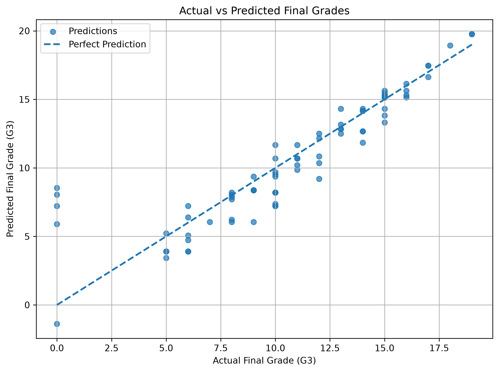
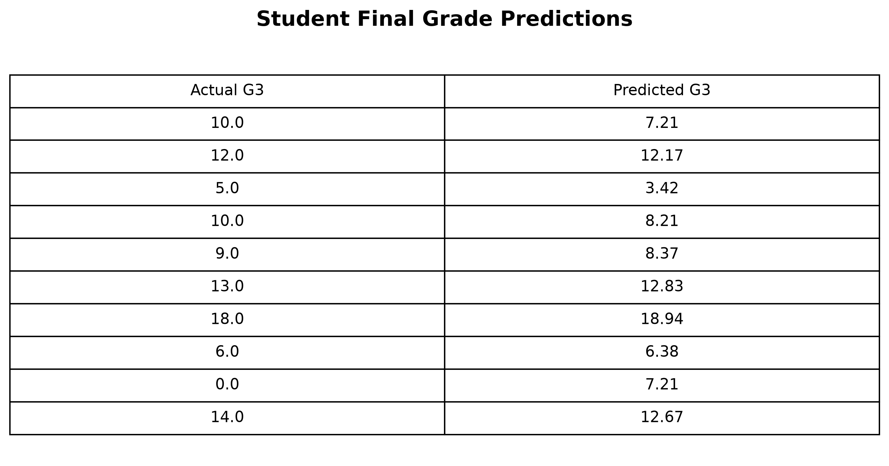

# ⚡ DevSphere AI & ML Internship — Week 3

<div align="center">

# 🎓 Student Final Grade Prediction

### Supervised Learning • Regression • Linear Regression

**A complete machine learning regression pipeline built with Python and Scikit-learn.**

<br>


<br>

**DevSphere AI & Machine Learning Internship**

`WEEK 03 • SUPERVISED LEARNING`

</div>

---

## 🧠 Project

This project implements a **Supervised Machine Learning Regression system** for predicting a student's final mathematics grade.

The model learns from two previous academic grades:

```text
G1 ───────┐
          ├──► Linear Regression ───► Predicted G3
G2 ───────┘
```

Where:

* **G1** → First-period grade
* **G2** → Second-period grade
* **G3** → Final grade / prediction target

The implementation covers the complete workflow from dataset preparation to model persistence.

---

## 🎯 Objective

> **Build, train, evaluate, visualize, and save a working Linear Regression model.**

### Core Pipeline

```text
📊 Dataset
   ↓
🧹 Feature Selection
   ↓
✂️ Train / Test Split
   ↓
🧠 Linear Regression
   ↓
🔮 Predictions
   ↓
📈 Evaluation
   ↓
📊 Visualization
   ↓
💾 Model Persistence
```

---

## 📦 Dataset

**Student Performance Mathematics Dataset**

| Property        | Details    |
| --------------- | ---------- |
| 📚 Records      | 395        |
| 🧩 Columns      | 33         |
| 🎯 Target       | `G3`       |
| 🔢 Features     | `G1`, `G2` |
| 🏋️ Training    | 80%        |
| 🧪 Testing      | 20%        |
| 🎲 Random State | `42`       |

The dataset contains student academic and demographic information.
For this regression task, `G1` and `G2` were selected as predictive features for the final grade `G3`.

---

## 🤖 Machine Learning Model

### Linear Regression

The project uses **Linear Regression** from Scikit-learn.

The model learns a relationship between the previous grades and the final grade:

```text
G3 = Intercept + (Coefficient₁ × G1) + (Coefficient₂ × G2)
```

The trained model is then used to generate predictions for previously unseen test samples.

---

## ⚙️ Implementation

### 01 — Data Loading

The dataset is loaded using Pandas:

```python
df = pd.read_csv("../data/student-mat.csv", sep=";")
```

### 02 — Feature Selection

```python
X = df[["G1", "G2"]]
y = df["G3"]
```

### 03 — Train / Test Split

```python
X_train, X_test, y_train, y_test = train_test_split(
    X,
    y,
    test_size=0.20,
    random_state=42
)
```

### 04 — Model Training

```python
model = LinearRegression()
model.fit(X_train, y_train)
```

### 05 — Prediction

```python
y_pred = model.predict(X_test)
```

### 06 — Evaluation

The model is evaluated using:

```text
MAE
MSE
RMSE
R² Score
```

### 07 — Model Persistence

The trained model is serialized using Pickle:

```python
with open(model_path, "wb") as file:
    pickle.dump(model, file)
```

---

## 📊 Evaluation Metrics

| Metric   | Purpose                           |
| -------- | --------------------------------- |
| **MAE**  | Average absolute prediction error |
| **MSE**  | Average squared prediction error  |
| **RMSE** | Prediction error in target units  |
| **R²**   | Explained variance of the model   |

These metrics provide multiple perspectives on regression performance rather than relying on a single measurement.

---

## 📈 Visual Results

### Actual vs Predicted

The project includes an **Actual vs Predicted Final Grades** visualization to compare the model's predictions against the real `G3` values.

<p align="center">
  
</p>

### Prediction Results

Sample predictions generated by the trained model are included as visual evidence.

<p align="center">
  
</p>

---

## 🗂️ Project Architecture

```text
DevSphere_ML_Week3/
│
├── 📁 data/
│   └── 📄 student-mat.csv
│
├── 📁 model/
│   └── 🧠 linear_regression_student_grade_model.pkl
│
├── 📁 notebook/
│   └── 📓 DevSphere_ML_Week3_Regression.ipynb
│
├── 📁 report/
│   ├── 📄 DevSphere_ML_Week3_Report.docx
│   └── 📕 DevSphere_ML_Week3_Report.pdf
│
├── 📁 screenshots/
│   ├── 🖼️ 01_actual_vs_predicted.png
│   └── 🖼️ 02_prediction_results.png
│
├── 📁 src/
│   └── 🐍 linear_regression.py
│
└── 📄 README.md
```

---

## 🛠️ Technology Stack

<div align="center">

| Technology              | Role                            |
| ----------------------- | ------------------------------- |
| 🐍 **Python**           | Core programming language       |
| 🐼 **Pandas**           | Dataset processing              |
| 🔢 **NumPy**            | Numerical computation           |
| 📊 **Matplotlib**       | Visualization                   |
| 🤖 **Scikit-learn**     | Machine learning                |
| 📓 **Jupyter Notebook** | Experimentation & documentation |
| 💾 **Pickle**           | Model persistence               |

</div>

---

## 📁 Project Components

### 📊 `data/`

Contains the dataset used for training and testing.

### 🧠 `model/`

Contains the serialized trained Linear Regression model.

### 📓 `notebook/`

Contains the complete interactive machine learning workflow.

### 📑 `report/`

Contains the professional Week 3 internship report in Word and PDF formats.

### 🖼️ `screenshots/`

Contains visual evidence of predictions and model results.

### 🐍 `src/`

Contains the standalone Python implementation of the regression pipeline.

---

## 🧪 Reproducibility

The project uses a fixed random state:

```text
random_state = 42
```

This keeps the train/test split reproducible when the workflow is executed again with the same dataset and environment.

---

## 🏆 Week 3 Deliverable

### Supervised Learning — Regression

| Requirement          | Status      |
| -------------------- | ----------- |
| 📊 Dataset           | ✅ Completed |
| 🧩 Feature Selection | ✅ Completed |
| ✂️ Train/Test Split  | ✅ Completed |
| 🧠 Linear Regression | ✅ Completed |
| 🏋️ Model Training   | ✅ Completed |
| 🔮 Predictions       | ✅ Completed |
| 📈 Evaluation        | ✅ Completed |
| 📊 Visualization     | ✅ Completed |
| 💾 Model Saving      | ✅ Completed |
| 📓 Notebook          | ✅ Completed |
| 📑 Report            | ✅ Completed |

---

## 💡 Learning Outcomes

This project strengthened practical understanding of:

* Supervised Machine Learning
* Regression problems
* Feature and target selection
* Train/test splitting
* Linear Regression
* Model training
* Prediction generation
* Regression evaluation
* Data visualization
* Model persistence
* Machine learning project organization

---

<div align="center">

## 🚀 Week 03 — Completed

**Learn → Build → Train → Predict → Evaluate → Save**

<br>

### DevSphere AI & Machine Learning Internship

**Ammar Akram**

BS Software Engineering • AI & Machine Learning • Python • Software Engineering

<br>

`2026`

</div>
