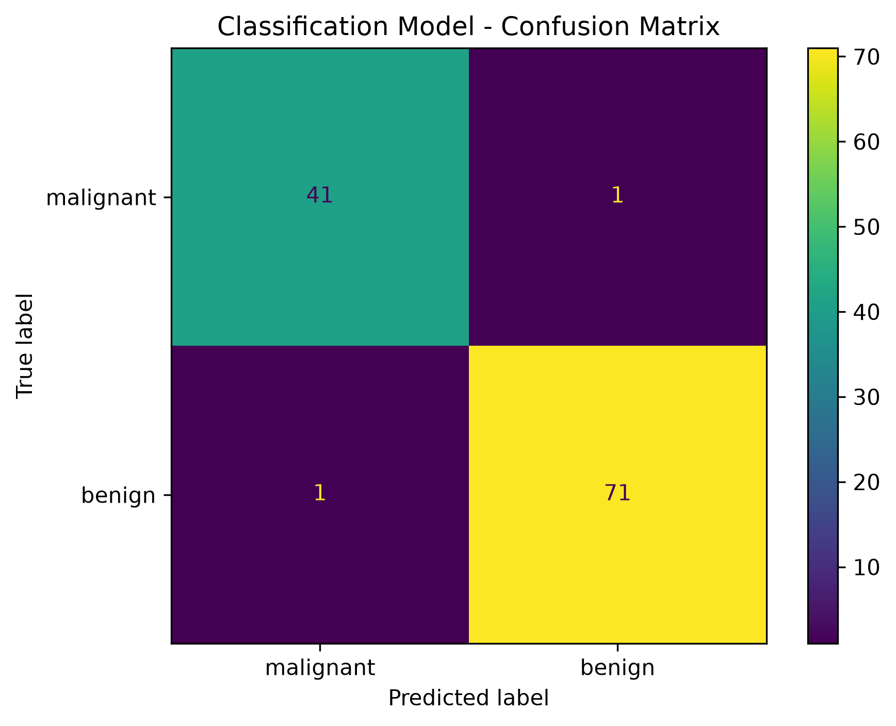

<div align="center">

# DevSphere AI & ML Internship — Week 4

### Classification Models

**Breast Cancer Classification using Logistic Regression**

<br>

[](https://www.python.org/)
[](https://scikit-learn.org/)
[](https://jupyter.org/)
[](#)

<br>


</div>

---

## ◈ Overview

This project was completed as part of the **DevSphere AI & ML Internship — Week 4**.

The project implements a complete supervised machine learning classification pipeline using the **Breast Cancer Wisconsin dataset** and a **Logistic Regression** model.

The workflow covers dataset preparation, train/test splitting, feature scaling, model training, prediction, evaluation, visualization, and model saving.

---

## ⚡ Machine Learning Pipeline

```text
                    CLASSIFICATION PIPELINE

                         ┌──────────────┐
                         │    DATASET   │
                         └──────┬───────┘
                                │
                                ▼
                    ┌─────────────────────┐
                    │ Feature Preparation │
                    └──────────┬──────────┘
                               │
                               ▼
                    ┌─────────────────────┐
                    │   Train / Test      │
                    │       Split         │
                    └──────────┬──────────┘
                               │
                               ▼
                    ┌─────────────────────┐
                    │   StandardScaler    │
                    └──────────┬──────────┘
                               │
                               ▼
                    ┌─────────────────────┐
                    │ Logistic Regression │
                    │      Training       │
                    └──────────┬──────────┘
                               │
                               ▼
                    ┌─────────────────────┐
                    │     Prediction      │
                    └──────────┬──────────┘
                               │
                               ▼
                    ┌─────────────────────┐
                    │     Evaluation      │
                    │ Accuracy + Matrix   │
                    └──────────┬──────────┘
                               │
                               ▼
                    ┌─────────────────────┐
                    │    Model Export     │
                    └─────────────────────┘
📊 Dataset

The project uses the Breast Cancer Wisconsin dataset provided through Scikit-learn.

Specification	Value
Dataset	Breast Cancer Wisconsin
Total Samples	569
Features	30
Training Samples	455
Testing Samples	114
Classes	Malignant / Benign
Test Size	20%
Random State	42
🧠 Classification Model
Logistic Regression

The classification algorithm used in this project is Logistic Regression.

Feature standardization was performed using:

StandardScaler()

The model was configured with:

LogisticRegression(
    max_iter=5000,
    random_state=42
)
🎯 Results
<div align="center">
98.25%
Test Accuracy
</div>
Metric	Result
Algorithm	Logistic Regression
Training Samples	455
Testing Samples	114
Test Accuracy	98.25%
🔍 Predictions

The trained model generated predictions for all 114 test samples.

Sample predictions:

[0, 1, 0, 1, 0, 1, 1, 0, 0, 0]

Dataset classes:

0 → Malignant
1 → Benign
🔲 Confusion Matrix

The resulting confusion matrix was:

[[41, 1],
 [1, 71]]
Visualization
<div align="center">



<sub>Figure 1 — Classification model confusion matrix.</sub>

</div>
📈 Classification Performance
Class	Precision	Recall	F1-Score
Malignant	0.98	0.98	0.98
Benign	0.99	0.99	0.99

Overall Test Accuracy: 98.25%

🗂️ Project Structure
DevSphere_ML_Week4/
│
├── data/
│
├── model/
│   └── classification_model.pkl
│
├── notebook/
│   └── DevSphere_ML_Week4_Classification.ipynb
│
├── report/
│   ├── DevSphere_ML_Week4_Report.docx
│   └── DevSphere_ML_Week4_Report.pdf
│
├── screenshots/
│   └── 01_confusion_matrix.png
│
├── src/
│   └── classification_model.py
│
└── README.md
🛠️ Technology Stack
Technology	Purpose
🐍 Python	Core implementation
🧮 Pandas	Data handling
🤖 Scikit-learn	Machine learning
📊 Matplotlib	Visualization
💾 Joblib	Model persistence
📓 Jupyter Notebook	Interactive development
⚙️ Implementation
src/classification_model.py

Contains the complete executable classification pipeline:

Dataset
   ↓
Feature Preparation
   ↓
Train / Test Split
   ↓
StandardScaler
   ↓
Logistic Regression
   ↓
Training
   ↓
Prediction
   ↓
Evaluation
   ↓
Confusion Matrix
   ↓
Model Export
notebook/

Contains the interactive Jupyter Notebook implementation and evaluation.

model/

Contains the serialized trained model:

classification_model.pkl

The saved model package contains:

Trained Logistic Regression model
StandardScaler
Feature names
Target class names
screenshots/

Contains the final classification visualization.

report/

Contains the project documentation in Word and PDF formats.

▶️ Run the Project

From the project directory:

python src/classification_model.py

The script performs:

✓ Load dataset
✓ Prepare features
✓ Split training and testing data
✓ Scale features
✓ Train Logistic Regression
✓ Generate predictions
✓ Calculate accuracy
✓ Generate classification report
✓ Generate confusion matrix
✓ Save trained model
✦ Learning Outcomes
Supervised machine learning
Classification
Dataset preparation
Train/test splitting
Feature scaling
Logistic Regression
Prediction
Accuracy evaluation
Classification reports
Confusion matrices
Model serialization
Jupyter Notebook workflow
◈ Final Result

The Week 4 classification pipeline was successfully implemented and evaluated.

<div align="center">
98.25% TEST ACCURACY

Dataset → Preprocessing → Training → Prediction → Evaluation → Model Export

<br>

DevSphere AI & ML Internship

Week 4 · Classification Models
<br>

Built • Trained • Evaluated • Saved

<br>

Ammar Akram

</div> ```