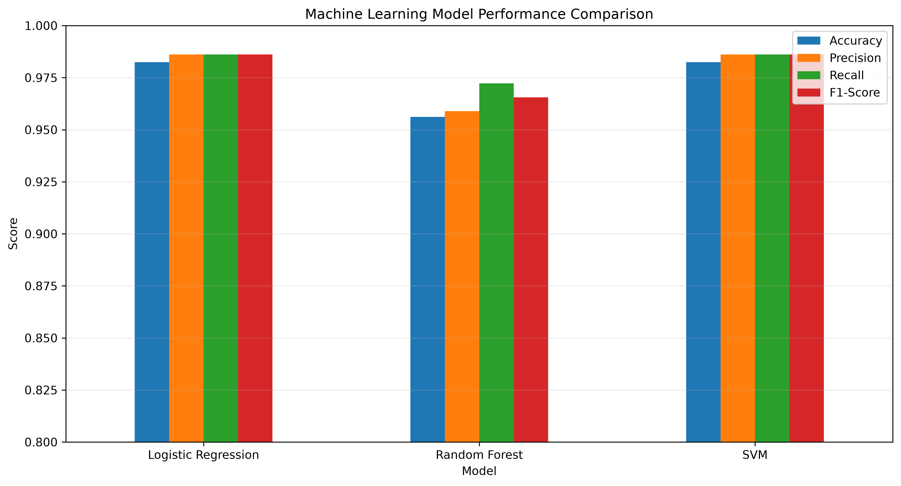
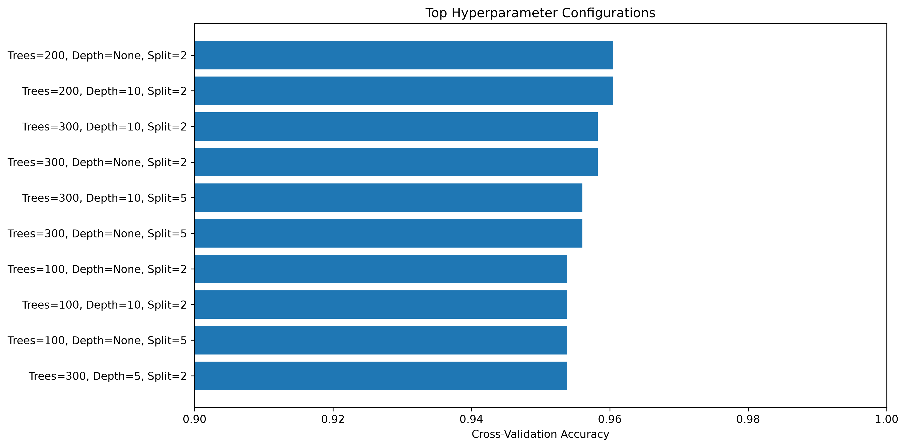
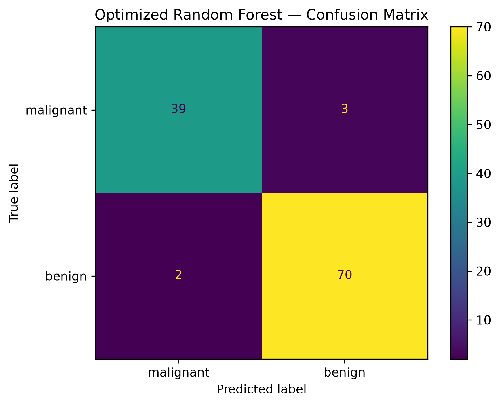

<div align="center">

# 🧠 Model Evaluation & Hyperparameter Tuning

### DevSphere AI & ML Internship — Week 5

*Training, comparing, tuning, and persisting an optimized classification model.*

<br>


</div>

---

## 📌 Overview

Week 5 of the **DevSphere AI & ML Internship** focuses on **model evaluation and tuning**. This project trains multiple classification models on the Breast Cancer Wisconsin Diagnostic dataset, compares them using standard evaluation metrics, tunes the Random Forest model with `GridSearchCV`, and saves the final optimized model for reuse.

The deliverables include a Python script, a Jupyter notebook, result visualizations, a persisted model file, and an evaluation report.

---

## 🔄 ML Pipeline

```text
┌──────────────┐   ┌───────────────┐   ┌───────────────┐
│   Dataset    │──▶│ Preprocessing │──▶│ Train / Test  │
│ Breast Cancer│   │               │   │ Split (80/20) │
└──────────────┘   └───────────────┘   └───────┬───────┘
                                               │
                                               ▼
┌──────────────┐   ┌───────────────┐   ┌───────────────┐
│  Evaluation  │◀──│    Tuning     │◀──│ Model Training│
│   & Report   │   │ (GridSearchCV)│   │  LR · RF · SVM│
└──────┬───────┘   └───────────────┘   └───────┬───────┘
       │                                       │
       ▼                                       ▼
┌──────────────┐                       ┌───────────────┐
│ Saved Model  │                       │  Comparison   │
│    (.pkl)    │                       │   of Metrics  │
└──────────────┘                       └───────────────┘
```

---

## 🗂️ Dataset

| Property | Details |
|---|---|
| **Source** | Breast Cancer Wisconsin Diagnostic Dataset |
| **Loader** | `sklearn.datasets.load_breast_cancer()` |
| **Samples** | 569 |
| **Features** | 30 |
| **Task** | Binary classification |
| **Train / Test Split** | 80% / 20% |
| **Split Strategy** | Stratified |
| **Random State** | `42` |

---

## 🤖 Models

| Model | Description |
|---|---|
| **Logistic Regression** | A linear classifier that estimates class probabilities; used as an interpretable baseline. |
| **Random Forest** | An ensemble of decision trees that combines their predictions; selected for the tuning stage. |
| **Support Vector Machine (SVM)** | A margin-based classifier that separates classes with an optimal decision boundary. |

---

## 📊 Performance Comparison

### Baseline Models

| Model | Accuracy | Precision | Recall | F1-Score |
|---|:---:|:---:|:---:|:---:|
| Logistic Regression | 98.25% | 98.61% | 98.61% | 98.61% |
| Random Forest | 95.61% | 95.89% | 97.22% | 96.55% |
| SVM | 98.25% | 98.61% | 98.61% | 98.61% |

### Optimized Model (After Tuning)

| Model | Accuracy | Precision | Recall | F1-Score |
|---|:---:|:---:|:---:|:---:|
| **Optimized Random Forest** | **95.61%** | **95.89%** | **97.22%** | **96.55%** |

> **Note:** Random Forest was the model selected for the tuning stage. Among the baseline models, Logistic Regression and SVM achieved the highest scores.

---

## 🎛️ Hyperparameter Tuning

Random Forest was optimized with **`GridSearchCV`**, which exhaustively evaluates every combination in a defined parameter grid using cross-validation and selects the best-performing configuration.

| Setting | Value |
|---|---|
| **Search Method** | `GridSearchCV` |
| **Cross-Validation** | 5-fold |
| **Scoring Metric** | Accuracy |

```python
param_grid = {
    "n_estimators": [100, 200, 300],
    "max_depth": [None, 5, 10],
    "min_samples_split": [2, 5]
}
```

---

## 🖼️ Visual Results

### Model Comparison

<p align="center">
  
</p>

### Tuning Results

<p align="center">
  
</p>

### Confusion Matrix

<p align="center">
  
</p>

---

## 🏆 Optimized Model

The final tuned Random Forest was evaluated on the held-out test set and saved for reuse.

| Metric | Score |
|---|:---:|
| Accuracy | 95.61% |
| Precision | 95.89% |
| Recall | 97.22% |
| F1-Score | 96.55% |

| Artifact | Path |
|---|---|
| **Saved Model** | `model/optimized_classification_model.pkl` |

The model is serialized with **Joblib**, so it can be loaded later for predictions without retraining.

---

## 📁 Project Structure

```text
DevSphere_ML_Week5/
├── data/
├── model/
│   └── optimized_classification_model.pkl
├── notebook/
│   └── DevSphere_ML_Week5_Model_Evaluation_Tuning.ipynb
├── report/
│   └── DevSphere_ML_Week5_Evaluation_Report.docx
├── screenshots/
│   ├── 01_model_comparison.png
│   ├── 02_tuning_results.png
│   └── 03_confusion_matrix.png
└── src/
    └── model_evaluation_tuning.py
```

---

## 🛠️ Tech Stack

<p align="center">
  
  
  
  
  
  
  
  
</p>

---

## ▶️ Run the Project

From the project root directory, run:

```bash
py src/model_evaluation_tuning.py
```

---

## ✅ Deliverables

- [x] Multiple trained models
- [x] Evaluation metrics (Accuracy, Precision, Recall, F1-Score)
- [x] Model comparison
- [x] Hyperparameter tuning with `GridSearchCV`
- [x] Optimized model saved as `.pkl`
- [x] Result charts
- [x] Confusion matrix
- [x] Jupyter notebook
- [x] Evaluation report

---

## 🎯 Conclusion

This project successfully demonstrates a complete model evaluation workflow: model comparison, metric-based evaluation, hyperparameter tuning, and model persistence.

<div align="center">

**DevSphere AI & ML Internship · Week 5**

</div>