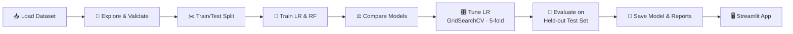
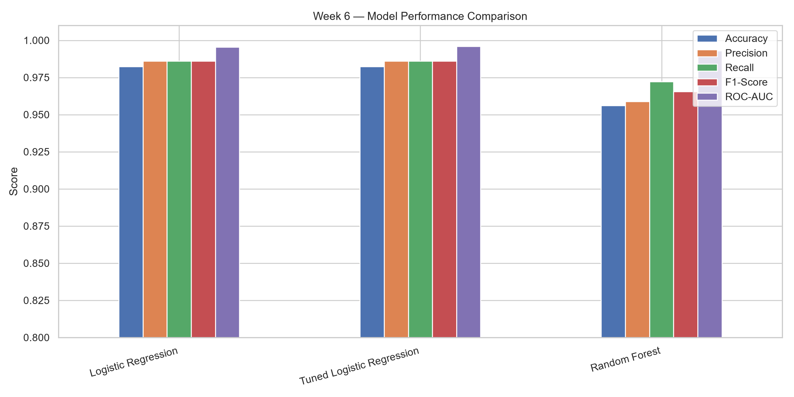
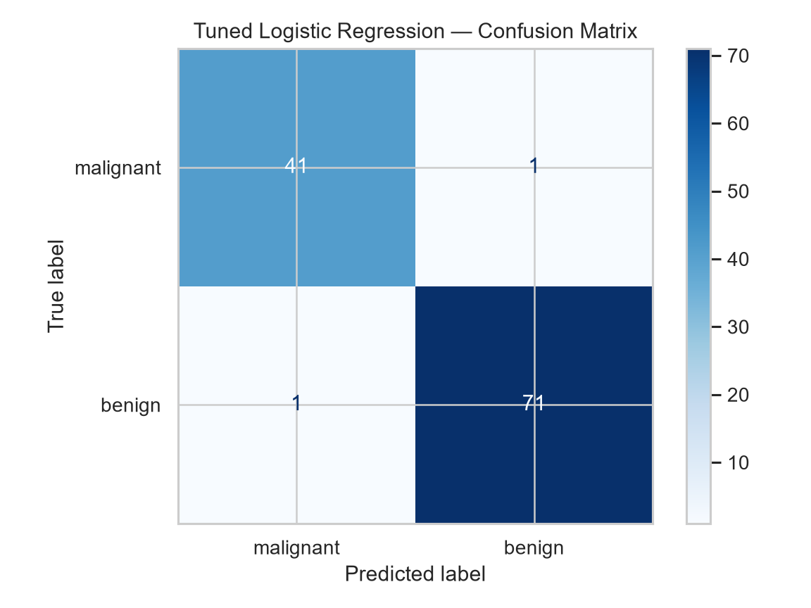
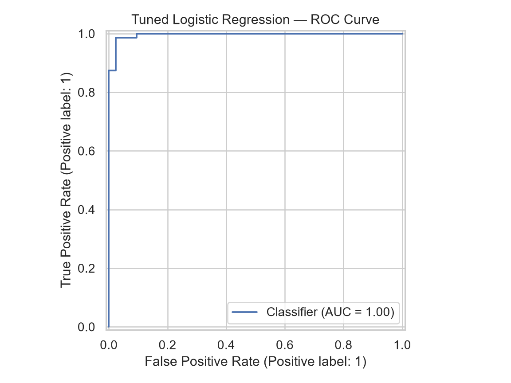

<div align="center">


<br>


**🧬 An end-to-end, educational machine-learning workflow: explore, train, tune, evaluate, and predict.**

*DevSphere AI & Machine Learning Internship · Week 6 Final Project*

[Overview](#-overview) · [Features](#-key-features) · [Workflow](#-workflow) · [Results](#-model-comparison--evaluation) · [Preview](#-preview) · [Quick Start](#-quick-start) · [Disclaimer](#-disclaimer)

</div>

<br>

> [!WARNING]
> **Educational project only.** This is a machine-learning learning exercise, **not a clinically validated diagnostic tool**. It must not be used for medical diagnosis or treatment decisions.

---

## 🔭 Overview

This project walks through a complete classification pipeline on the **Breast Cancer Wisconsin** dataset bundled with Scikit-learn (**569 samples · 30 numeric features**). It covers data exploration, preprocessing, model training, hyperparameter tuning, evaluation, visualization, and an interactive **Streamlit** app that returns a class prediction with estimated probabilities.

Target encoding follows the original dataset: `0` = Malignant, `1` = Benign.

---

## ✨ Key Features

<table>
<tr>
<td width="33%" valign="top">

### 📊 Data Exploration
Feature statistics, class distribution, and checks for missing or infinite values.

</td>
<td width="33%" valign="top">

### 🤖 Model Comparison
Logistic Regression and Random Forest trained and compared side by side.

</td>
<td width="33%" valign="top">

### 🎛️ Hyperparameter Tuning
Logistic Regression tuned with `GridSearchCV` and five-fold cross-validation.

</td>
</tr>
<tr>
<td width="33%" valign="top">

### 📈 Rich Evaluation
Accuracy, precision, recall, F1-score, ROC-AUC, confusion matrix, and classification report.

</td>
<td width="33%" valign="top">

### 💾 Saved Artifacts
Serialized model plus CSV and text evaluation reports for reproducibility.

</td>
<td width="33%" valign="top">

### 🖥️ Interactive App
Enter feature measurements in Streamlit and view the predicted class and probabilities.

</td>
</tr>
</table>

---

## 🧰 Technology Stack

| Layer | Tools |
|:--|:--|
| 🐍 **Language** | Python |
| 🧮 **Data** | Pandas · NumPy |
| 🎨 **Visualization** | Matplotlib · Seaborn |
| 🧠 **Machine Learning** | Scikit-learn · Joblib |
| 📓 **Experimentation** | Jupyter Notebook |
| 🌐 **Application** | Streamlit |

---

## 🔄 Workflow



---

## 📊 Model Comparison & Evaluation

| Stage | Model | Method |
|:--|:--|:--|
| 1️⃣ Baseline | **Logistic Regression** | Trained on the training split |
| 1️⃣ Baseline | **Random Forest** | Trained on the training split |
| 2️⃣ Tuned | **Logistic Regression** | `GridSearchCV`, five-fold cross-validation |
| 3️⃣ Final check | **Selected model** | Evaluated on the held-out test set |

**Metrics reported:** Accuracy · Precision · Recall · F1-score · ROC-AUC · Confusion matrix · Classification report

📁 **Actual results** are recorded in the generated files, which are the source of truth for every number:

| File | Contents |
|:--|:--|
| [`report/model_comparison.csv`](report/model_comparison.csv) | Metrics for the compared models |
| [`report/final_evaluation_metrics.csv`](report/final_evaluation_metrics.csv) | Final held-out test-set metrics |
| [`report/evaluation_report.txt`](report/evaluation_report.txt) | Text evaluation and classification report |

---

## 🖼️ Preview

<table>
<tr>
<td align="center" width="33%">
<br>
<sub><b>📊 Model Comparison</b></sub>
</td>
<td align="center" width="33%">
<br>
<sub><b>🧩 Confusion Matrix</b></sub>
</td>
<td align="center" width="33%">
<br>
<sub><b>📈 ROC Curve</b></sub>
</td>
</tr>
</table>

---

## 🚀 Quick Start

> Commands use the Windows `py` launcher. On macOS or Linux, replace `py` with `python3`.

**1️⃣ Install dependencies**

```bash
py -m pip install pandas numpy matplotlib seaborn scikit-learn joblib streamlit notebook
```

**2️⃣ Train and evaluate** (from the project root)

```bash
py src/prediction_system.py
```

**3️⃣ Launch the Streamlit app**

```bash
py -m streamlit run src/prediction_app.py
```

**4️⃣ Or explore the notebook**

```bash
py -m notebook
```

Then open the `notebook` folder and run `Week6_Breast_Cancer_Prediction.ipynb`.

---

## 🗂️ Project Structure

```text
DevSphere_ML_Week6/
├── assets/
│   └── banner.svg
├── data/
├── model/
│   └── prediction_model.joblib
├── notebook/
│   └── Week6_Breast_Cancer_Prediction.ipynb
├── report/
│   ├── model_comparison.csv
│   ├── final_evaluation_metrics.csv
│   └── evaluation_report.txt
├── screenshots/
│   ├── 01_model_comparison.png
│   ├── 02_confusion_matrix.png
│   └── 03_roc_curve.png
├── src/
│   ├── prediction_system.py
│   └── prediction_app.py
└── README.md
```

---

## ⚠️ Disclaimer

This project is for **educational purposes only**. Predictions and probabilities are statistical outputs learned from a public benchmark dataset, not confirmed medical findings. Strong performance on this dataset does **not** establish clinical reliability. Do not use it for medical diagnosis or treatment decisions.

---

## 🔮 Future Improvements

- 📦 Add a pinned `requirements.txt` for one-command setup
- 🧪 Compare additional models with cross-validated metrics
- 🔍 Add feature-importance and model-explainability views
- 🎯 Explore probability calibration and threshold analysis
- ✅ Add automated tests for the training and prediction code
- ☁️ Deploy the Streamlit app for easy demonstration

---

<div align="center">

**🎓 DevSphere AI & Machine Learning Internship · Week 6**

<sub>Built for learning · Not for clinical use</sub>

</div>
